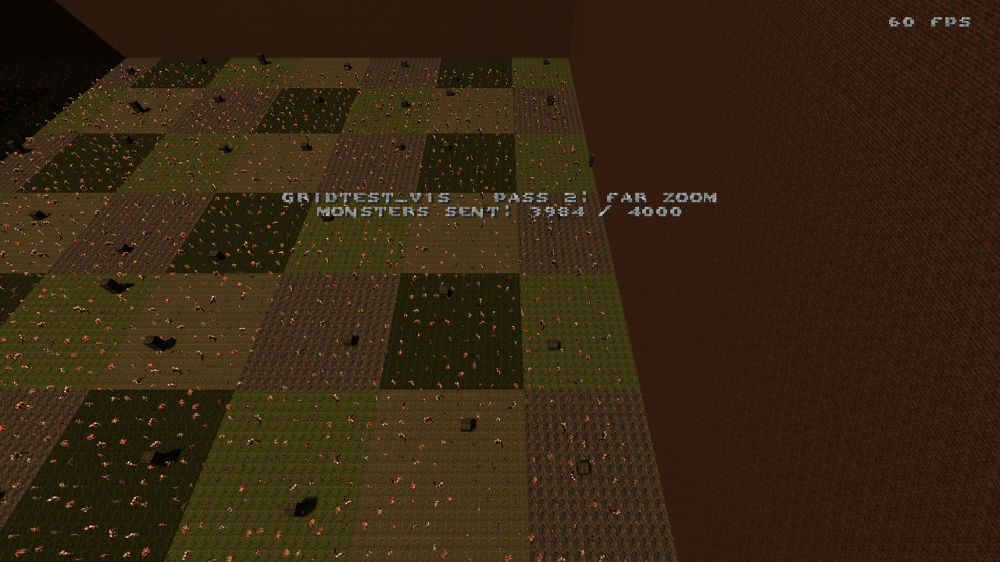
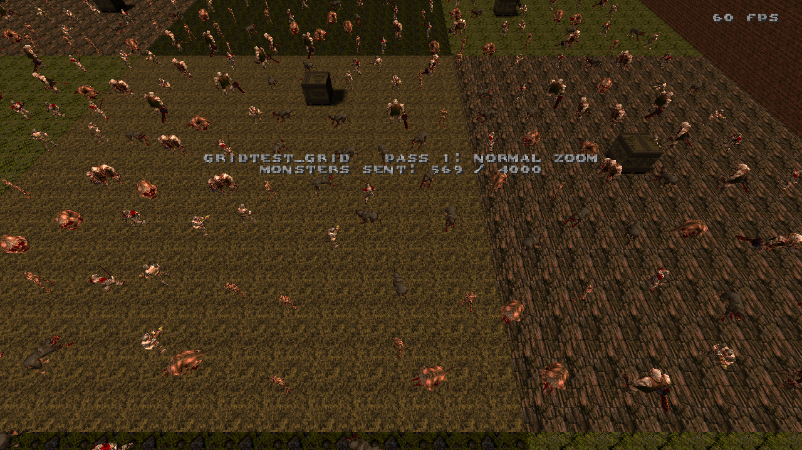

# gridvis

A visibility compiler for Quake maps with a **top-down camera**: strategy games, Vampire Survivors-likes, RPGs, ARPGs.

`gridvis` replaces `vis` from [ericw-tools](https://github.com/ericwa/ericw-tools). Instead of tracing line of sight through portals, it builds the PVS from the patch of ground the screen can show around the camera. The server then only sends, and the client only draws, the entities near the screen.

| Normal `vis`: 3984 of 4000 monsters sent | `gridvis`: 538 of 4000 monsters sent |
|---|---|
|  |  |

Both screenshots show the same map at the same moment, with the camera zoomed out far beyond the normal play zoom so the culling is visible. At play zoom the two maps look the same:



## Why

Quake's `vis` was made for corridors and rooms seen at eye level. With a top-down camera it fails in two ways:

- **Open areas have nothing to occlude.** Every leaf sees every other leaf, so nothing is culled. With thousands of entities, all of them are sent over the network and drawn every frame.
- **Occlusion at eye level is wrong.** The camera looks over walls, so portal vis can hide a room that is clearly on screen.

What a top-down camera can see depends on the screen, not on walls. `gridvis` uses that.

## Results

On the test map (an 8000×8000 open field with 4000 idle monsters, measured on an RTX 5060 Laptop machine):

| | `vis` | `gridvis` |
|---|---|---|
| Compile time | 44–47.5 s | 0.2 s (~220× faster, 99.5% less time) |
| Monsters the client receives per frame | 3999 of 4000 | 536–811 of 4000 |
| Demo size of the same scripted run | 38 MB | 5.6 MB |

`gridvis` also handles big maps: quakemash (40,988 leafs) takes 1 s.

The monster counts come from the engine's own network log (`cl_shownet 2`), counted by `tools/netcheck.py`. The demo sizes come from an earlier run with a slightly smaller footprint. See [gridvis.md](gridvis.md) for the details.

## How it works

1. For every BSP leaf, take its bounding box on the ground plane (X and Y; height is ignored).
2. Grow it by the **footprint**: the size of the ground the screen shows at the furthest zoom the game allows, plus a margin.
3. Every leaf whose box touches that area is visible from the first leaf.
4. Write the result as a standard Quake PVS.

The output is a normal BSP file, so **no engine changes are needed**. BSP29, BSP2 and Hexen 2 maps are supported; Quake 2 maps are not. No `.prt` file is needed.

## Usage

```
gridvis [options] mapname.bsp
```

| Option | Default | Meaning |
|---|---|---|
| `-rectx W` | 2048 | Footprint width (world X) in units |
| `-recty H` | 2048 | Footprint depth (world Y) in units |
| `-offsetx X`, `-offsety Y` | 0 | Moves the footprint relative to the player. A tilted camera sees more ground ahead than behind |
| `-radius R` | off | Circular footprint instead of a rectangle, for cameras that rotate |
| `-margin M` | 64 | Extra border, so entities don't pop in at the screen edge |
| `-stats` | off | Prints a leaf size histogram |

`gridvis` also takes the common ericw-tools options, such as `-threads` and `-nocolor`.

A typical compile:

```sh
python tools/hintgrid.py mymap.map mymap_hint.map --grid 512
qbsp mymap_hint.map
light mymap_hint.bsp
gridvis -rectx 3328 -recty 1536 -offsety 464 -margin 128 mymap_hint.bsp
```

### Important: maps need a grid of hint planes

**For `gridvis` to work as expected, the map should have a grid of hint planes over its playable area.** Without it, open areas may not be culled at all.

#### Why

`qbsp` cuts the empty space of a map into convex pieces, the *leafs* of the BSP tree. The PVS is stored per leaf ("from this leaf, these other leafs are visible"), and an entity is sent and drawn when its leaf is visible. So culling can never be finer than the leafs.

`qbsp` only cuts space along the faces of brushes. Open air has no brushes, so a big open area stays one huge leaf. A huge leaf touches the footprint from almost anywhere, so it is visible from almost everywhere. When the camera or the player is inside it, everything is visible.

The test map (8000×8000 units, open field), compiled with and without a hint grid:

| | Without hint grid | With a hint plane every 512 units |
|---|---|---|
| Leafs | 219 | 1607 |
| Largest leaf | 8000 units wide: all the air above the map is one leaf | 512 units wide |
| Faces | 4919 | 4935 |
| Culling | none: the camera is inside the 8000-unit leaf, so the whole map is visible | about 13–20% of the monsters are sent |

#### What hint planes are

A hint brush is a standard Quake mapping tool. Its face textured `hint` tells `qbsp` to split space along that plane; its other faces are textured `hintskip` and are ignored. Hint brushes:

- **are invisible**: they generate no drawn faces;
- **are not solid**: players, monsters and projectiles go through them;
- **don't change the look of the map**: on the test map they split only 16 faces, along the grid lines.

The only visible effect is indirect: the edge of the culled area follows the grid lines. You can see it in the far-zoom screenshot above, where the patch of monsters has straight edges.

#### How to add the grid

- **Automatically:** `tools/hintgrid.py` adds the grid to any `.map`. By default it covers the bounds of the worldspawn brushes, full height. `--bounds` limits it to an area.

  ```sh
  python tools/hintgrid.py mymap.map mymap_hint.map --grid 512
  ```

- **By hand** in the map editor: add thin brushes that span the playable area, one every N units in X and in Y. Give one face the `hint` texture and the other faces `hintskip`.

#### Choosing the grid size

Use a spacing well below the footprint size: 512 works for a footprint around 2000–3500 units. A smaller grid gives a tighter culling edge, but more leafs, a bigger BSP and more visdata.

#### Checking it

`gridvis` prints the largest leaf it finds, and a `WARNING` when some leafs are bigger than the footprint. `-stats` adds a histogram of leaf sizes. Sky and solid leafs are not counted.

### Things to know

- The PVS point is the player's origin + `view_ofs`. Keep the player entity at the camera focus, or make `view_ofs` point to it.
- Monster AI uses the PVS too (`checkclient()`), so monsters wake up when they are near the screen, not when they see the player.
- Ambient sounds are not computed.

## Building

Windows, with Visual Studio (C++ workload) and CMake:

```bat
build.bat            :: builds all of ericw-tools, including gridvis
build.bat gridvis    :: only gridvis
```

Embree and TBB are downloaded on the first run. The tool is built at `ericw-tools\build-windows\gridvis\Release\gridvis.exe`.

On Linux, `./build.sh gridvis` builds it at `ericw-tools/build-linux/gridvis/gridvis`.

## Test map and demo mod

The repository includes everything used to measure it:

| Path | What |
|---|---|
| `tools/makemap.py` | generates the test map (open field, crates, hint grid) |
| `compile.bat` | compiles it twice from the same `.map`: once with `vis`, once with `gridvis` |
| `mod/` | a small QuakeC mod: spawns 4000 idle monsters and flies a scripted top-down camera over them, at normal and at far zoom |
| `play.bat [vis\|grid]` | opens one of the two maps in [ironwail](https://github.com/andrei-drexler/ironwail) |
| `tools/bench.py` | records and times a demo of the run on both maps |
| `tools/netcheck.py` | counts the entities the client really receives on both maps |

The scripts expect Quake in `D:\quake` with `ironwail.exe`; edit the paths at the top of the scripts if yours is elsewhere. The mod is compiled with the bundled `fteqcc64.exe` (`mod\build.bat`).

## Status

This is a working prototype, tested with ironwail. The design notes, measurements and open questions are in [gridvis.md](gridvis.md).

## Credits and license

- Built on [ericw-tools](https://github.com/ericwa/ericw-tools), vendored in `ericw-tools/`, and on the build setup of vklight.
- The code in `ericw-tools/` (including `gridvis`) is covered by the ericw-tools license: GPL, see `ericw-tools/COPYING` and `ericw-tools/gpl_v3.txt`.
- The test mod uses the standard Quake definitions (`defs.qc`) from id Software's QuakeC source.

## AI was used to make this

`gridvis`, the test map tools and the test mod were written with Claude Code.
